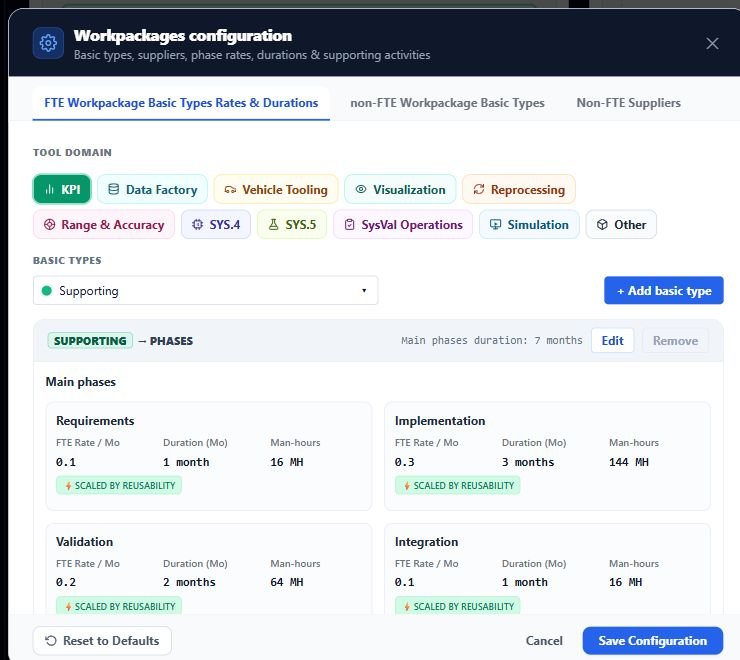
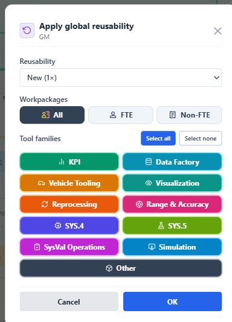
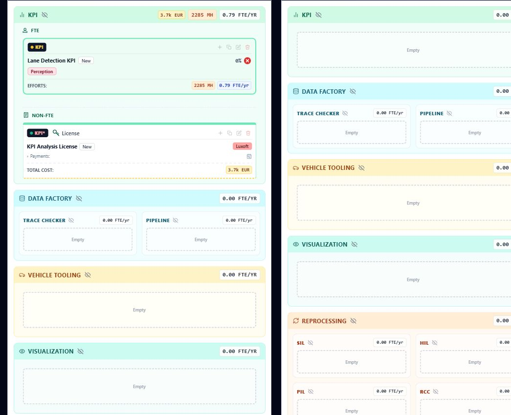
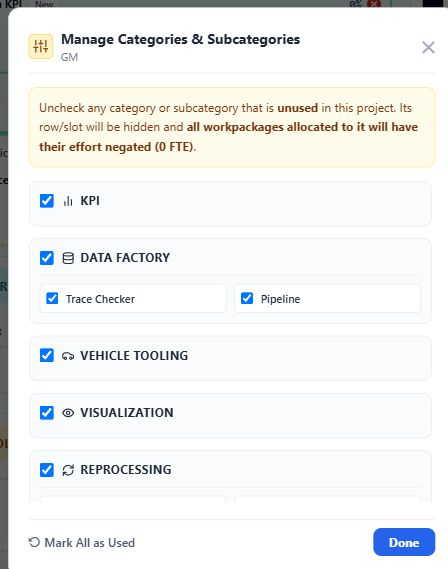
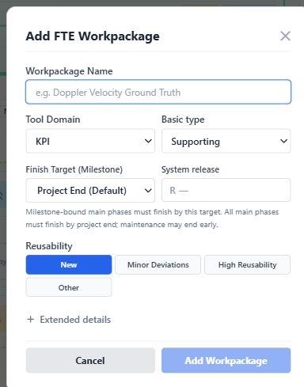
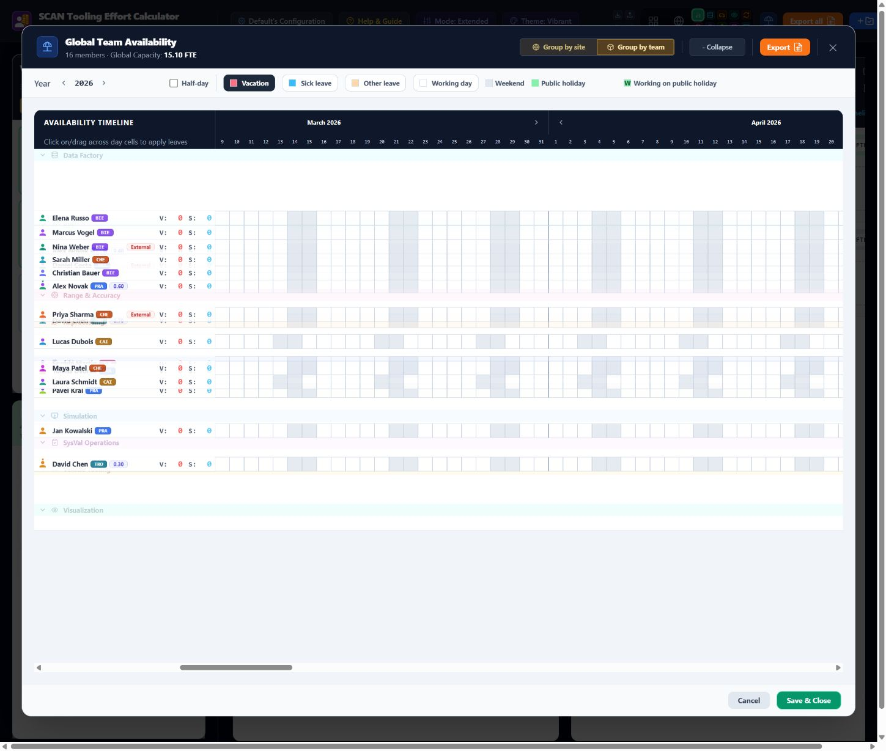

# Layout and scalability audit

Audited against the running app on 2 November 2026; preserved 3 November 2026.
These are screenshots of existing screens, not simulations of a new category.
No new category was installed and no live planning edits were saved.

## 1. Top navigation: hard count limit

The header explicitly renders TEST_TOOLS.slice(0, 5) and slice(5, 10). An eleventh
non-Other category would have no team-view button. Use scalable navigation.
Source: [App.tsx](../../../src/App.tsx).

## 2. Workpackages configuration: wrapping category buttons

The Tool Domain buttons already occupy two rows. Another category fits through
wrapping, but many/long names push configuration further down. Consider a
searchable picker. Category-specific style/icon lookups also need generalization.

## 3. Bulk reusability: narrow two-column category selector

One additional category fits the current six rows by sharing Other's full-width
last row. There is no immediate numeric limit here. More categories or long names
increase scrolling/button heights; retain the dialog's scrolling behaviour.

## 4. Project swimlanes: vertical growth and subcategory panels

Each visible category adds a panel to each project, including empty panels.
Subcategories use two-column layouts and special handling for three items.
Additional categories/subcategories increase scroll distance even where they fit.
Consider avoiding empty panels or more scalable disclosure controls.

[Full project-view screenshot](06-project-swimlanes.jpg)

## 5. Project category usage: already bounded and scrollable

The existing list has a bounded scrolling region. It needs dynamic registry
references and category-scoped subcategories, rather than a major layout redesign.

## Other inspected screens

Add Workpackage uses a native category dropdown. Staffing/spending timelines and
availability team grouping already support additional vertical rows reasonably.
Do not redesign them solely because one category is added; update their references,
colours/icons and terminology consistently.

## Priority

Fix the header's hard limit first; improve category selection in configuration
and reusability next; address empty-panel clutter in project swimlanes. Preserve
working dropdown/scroll patterns elsewhere. Supported category-count limits still
need real layout/performance testing before promising a maximum.
