# Category terminology audit

Audit completed 3 November 2026. Read-only terminology review; no application source or planning data was changed. Screenshots from the live workspace were captured before the interruption; Help, import, chart and extra form examples were completed in an isolated temporary demo tab. No sample import was applied. Native tooltip text is transcribed where screenshots do not include the native popup. Source-only cases are explicitly marked.

## Proposed terminology

- Tool / Tool domain / Tool family → Category
- Subtool → Subcategory
- Tool team → Category’s team (retain Team for people and staffing)
- Keep Basic type distinct from Category; use FTE/Non-FTE kind when describing those two kinds.

## Application inventory

### 1. FTE workpackage creation

Current wording: **Tool Domain**

Suggested wording: **Category**

Captured in the active workspace. The inline FTE editor already uses an unlabelled category selector rather than the word Tool.

Source: [src/components/features/AddFunctionModal.tsx:134](../../../src/components/features/AddFunctionModal.tsx#L134)

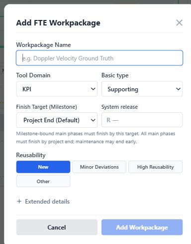

### 2. Non-FTE creation and editing

Current wording: **Tool Domain; Subtool; hover: Tool Domain: <category>; hover: Subtool**

Suggested wording: **Category; Subcategory**

The full dialog shows both labels. Inline editing visually hides some labels but preserves them for accessibility and titles; see 02-edit-nonfte-workpackage.jpg. The Data Factory selection was made only in a cancelled new-workpackage draft.

Source: [src/components/features/NonFteWorkpackageModal.tsx:118](../../../src/components/features/NonFteWorkpackageModal.tsx#L118)

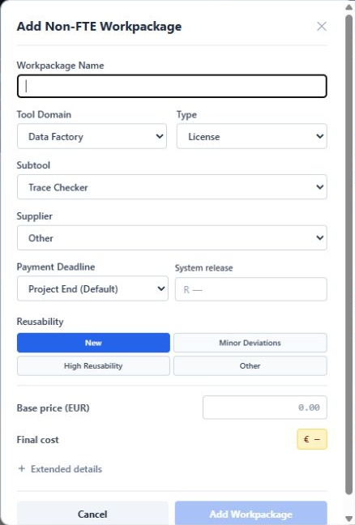

### 3. Workpackages configuration

Current wording: **TOOL DOMAIN**

Suggested wording: **CATEGORY**

The category selector heading refers to the workpackage grouping, not equipment.

Source: [src/components/features/ConfigurationModal.tsx:435](../../../src/components/features/ConfigurationModal.tsx#L435)

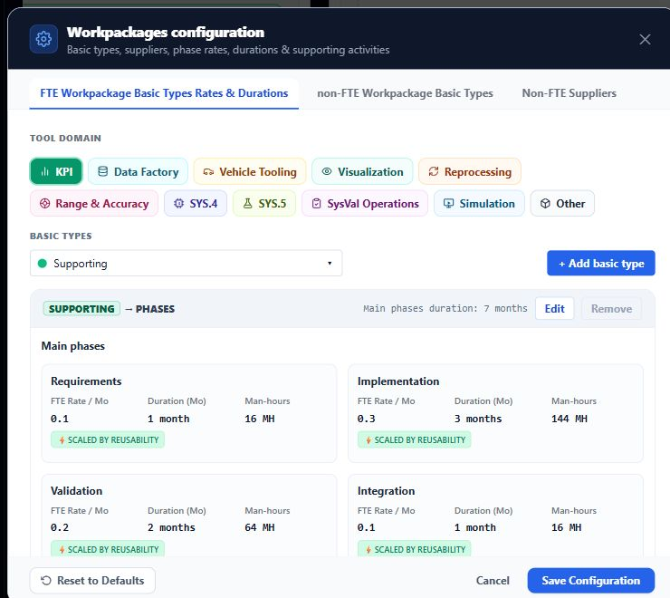

### 4. Basic-type validation

Current wording: **Enter a unique basic type name for this tool.**

Suggested wording: **Enter a unique basic type name for this category.**

Same wording exists at line 172 for creation. A duplicate-name draft was rejected and discarded; no configuration was saved.

Source: [src/components/features/ConfigurationModal.tsx:156](../../../src/components/features/ConfigurationModal.tsx#L156)

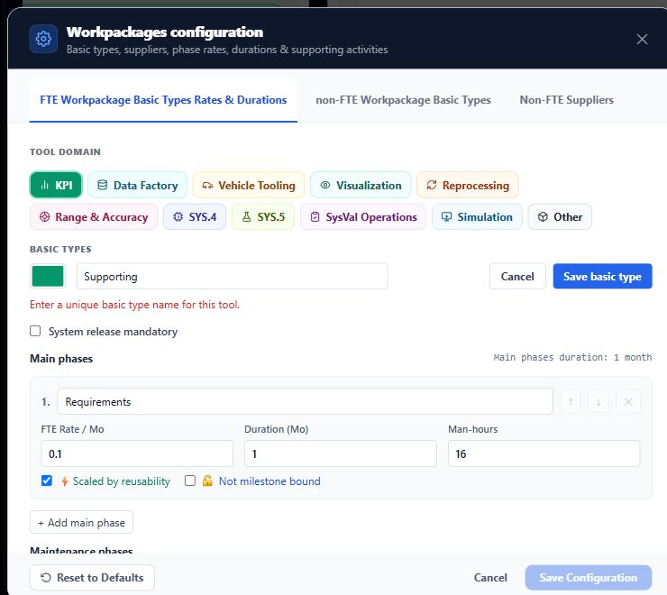

### 5. Defaults / Management Support

Current wording: **...each month and tool domain...; Combined engineering FTE within a tool...**

Suggested wording: **...each month and category...; Combined engineering FTE within a category...**

Two descriptions: the rules explanation at line 777 and threshold explanation at line 790.

Source: [src/components/features/ConfigurationModal.tsx:777](../../../src/components/features/ConfigurationModal.tsx#L777)

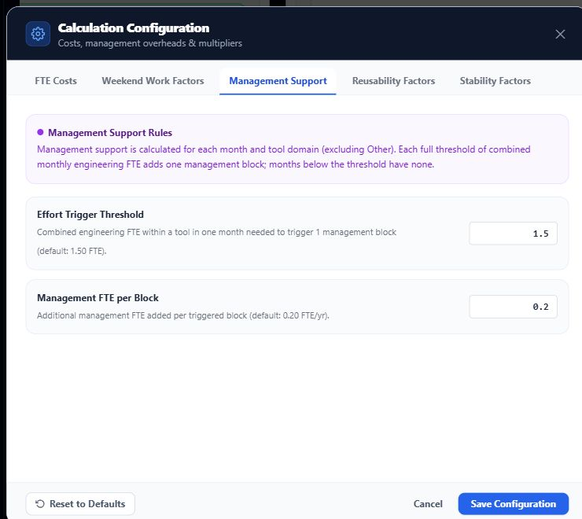

### 6. Apply global reusability

Current wording: **Tool families**

Suggested wording: **Categories**

The same label is used in the overall and team-specific views.

Source: [src/components/features/ProjectReusabilityModal.tsx:90](../../../src/components/features/ProjectReusabilityModal.tsx#L90)

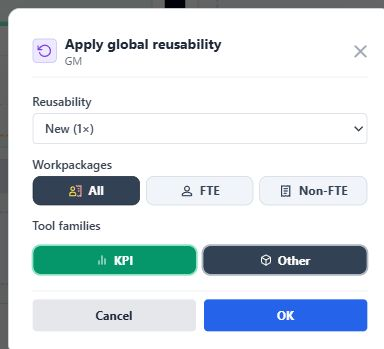

### 7. Project category cost badge hover

Current wording: **Project tool cost: 3,700.00 EUR, including non-FTE purchases or external salary × allocated FTE ÷ member FTE.**

Suggested wording: **Project category cost: ...**

Exact native title read from the active cost badge. Native tooltip bubbles were not captured in the screenshot; this is a transcription, not a simulated tooltip. Missing-rate variants append a partial-cost sentence.

Source: [src/components/ui/WorkpackageCostLabel.tsx:45](../../../src/components/ui/WorkpackageCostLabel.tsx#L45)

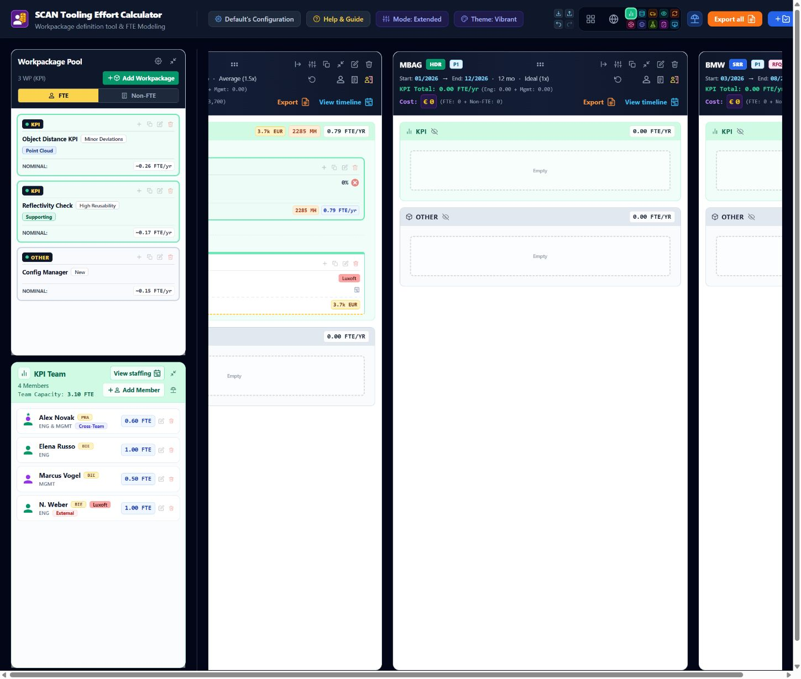

### 8. Member allocation empty state

Current wording: **No team members found for <category>. Add members to this tool first.**

Suggested wording: **No team members found for <category>. Add members to this category’s team first.**

Conditional message confirmed in source, not reproduced in the user workspace.

Source: [src/components/features/AssignMemberToWPModal.tsx:431](../../../src/components/features/AssignMemberToWPModal.tsx#L431)

### 9. Selective import / Workpackages

Current wording: **Same-name matches are suggested only within the mapped project, tool and FTE/non-FTE category.**

Suggested wording: **...within the mapped project, workpackage category and FTE/non-FTE kind.**

A frozen compatibility fixture was opened for preview only in an isolated demo tab; import was cancelled. Related conflict message: Choose a valid project/tool match for <workpackage> (selectiveWorkspaceImport.ts:225).

Source: [src/components/features/SelectiveImportReview.tsx:86](../../../src/components/features/SelectiveImportReview.tsx#L86)

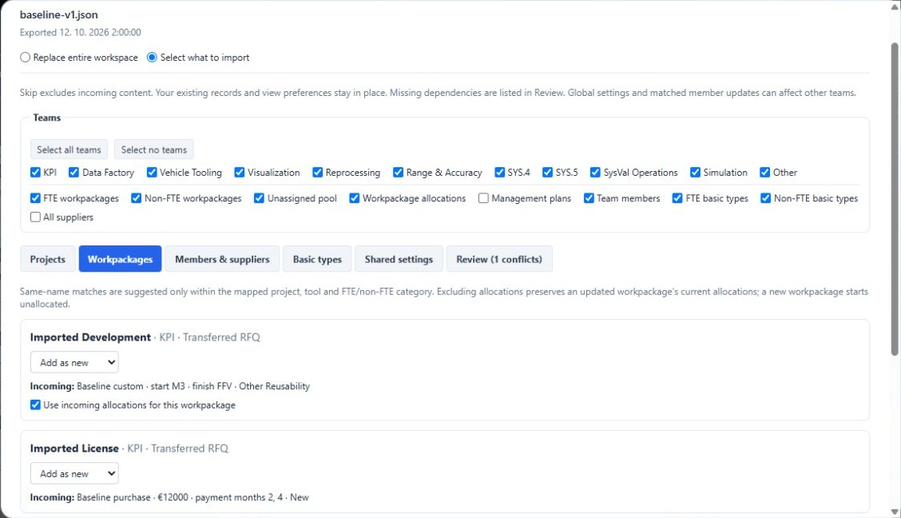

### 10. Undo and Redo hover descriptions

Current wording: **Undo: Toggle tool; Redo: Toggle tool; Toggle subtool**

Suggested wording: **Toggle category; Toggle subcategory**

Tool history label is defined at App.tsx:784. A category was toggled and undone only in the isolated demo; native hover text was read directly and is transcribed here.

Source: [src/App.tsx:771](../../../src/App.tsx#L771)

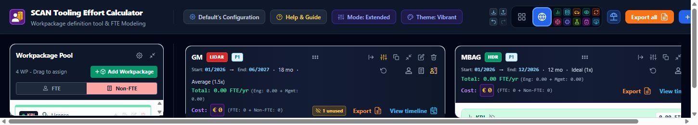

### 11. Spending graphs and monthly accessibility readouts

Current wording: **All tools**

Suggested wording: **All categories**

Shown when no nonzero category series are available. The same series label appears in monthly chart accessibility/readout text.

Source: [src/components/ui/ProjectSpendingCharts.tsx:96](../../../src/components/ui/ProjectSpendingCharts.tsx#L96)

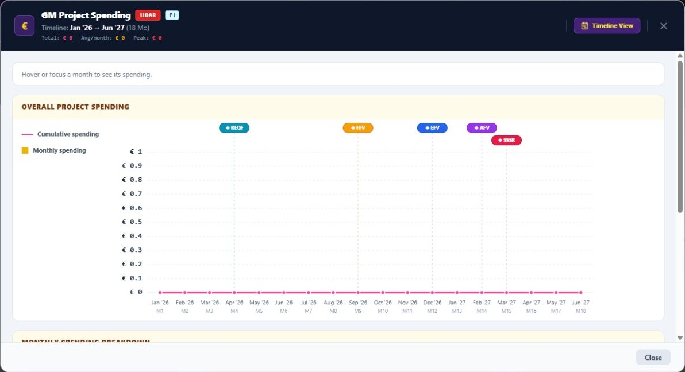

### 12. Spending chart accessibility descriptions

Current wording: **Monthly spending stacked by tool, including each tool's management support and purchase costs. Hover or focus a month for its breakdown.**

Suggested wording: **Monthly spending stacked by category, including each category’s management support and purchase costs. ...**

Overall-view aria-label. The line-205 category-specific alternative also says engineering tool and each tool’s color; both require updating. Accessibility text is not a native hover bubble.

Source: [src/components/ui/ProjectSpendingCharts.tsx:204](../../../src/components/ui/ProjectSpendingCharts.tsx#L204)

### 13. Workspace import validation errors

Current wording: **Tool FTE rates; Member tool; Workpackage tool; Scope tool**

Suggested wording: **Category FTE rates; Member category; Workpackage category; Scope category**

Diagnostic paths at lines 166/168/171, 257, 270 and 308. Change human-readable error labels without blindly renaming schema-1 JSON fields.

Source: [src/utils/workspaceFile.ts:166](../../../src/utils/workspaceFile.ts#L166)

### 14. XLSX / Site hourly rates helper list

Current wording: **Tool keywords**

Suggested wording: **Category keywords**

Visible workbook helper heading; source-confirmed, not an app screen. ExportToolKeywords is an internal named range and not a UI label. Preserve historical export contracts unless intentionally migrated.

Source: [src/utils/projectPlanningXlsx.ts:410](../../../src/utils/projectPlanningXlsx.ts#L410)

## Help & Guide: 25 passages across ten tabs

All passages below refer to workpackage categories and should be reviewed together. Screenshots show a representative occurrence per tab; they do not imply every paragraph is simultaneously visible.

### Save & Transfer Workspace

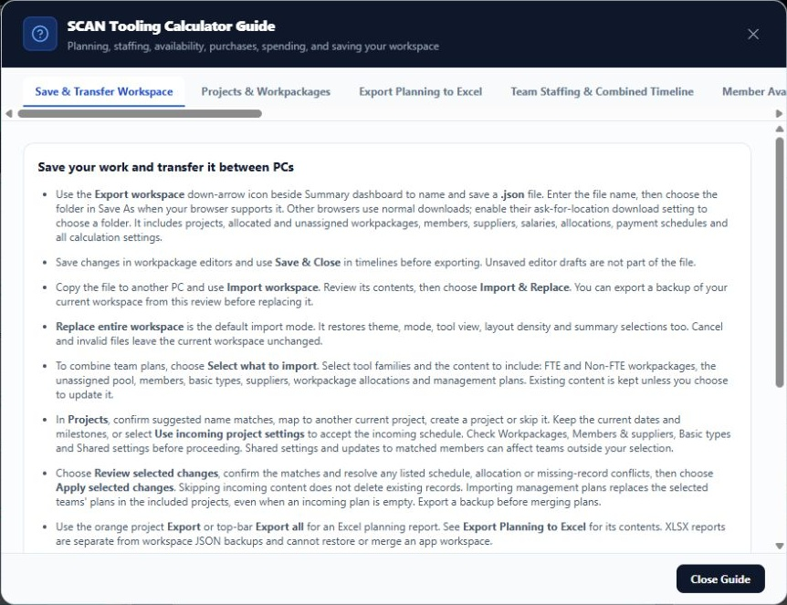

- Line 126: Replace entire workspace is the default import mode. It restores theme, mode, tool view, layout density and summary selections too. Cancel and invalid files leave the current workspace unchanged.
- Line 127: To combine team plans, choose Select what to import. Select tool families and the content to include: FTE and Non-FTE workpackages, the unassigned pool, members, basic types, suppliers, workpackage allocations and management plans. Existing content is kept unless you choose to update it.

### Projects & Workpackages

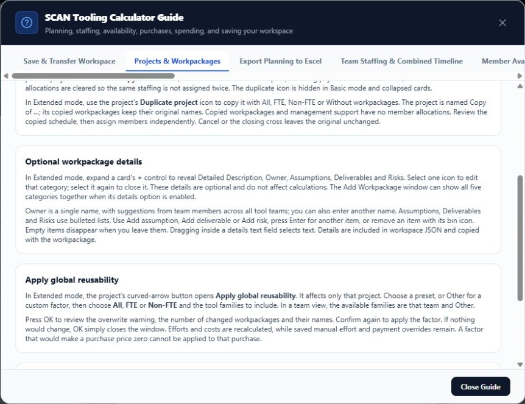

- Line 154: Owner is a single name, with suggestions from team members across all tool teams; you can also enter another name. Assumptions, Deliverables and Risks use bulleted lists. Use Add assumption, Add deliverable or Add risk, press Enter for another item, or remove an item with its bin icon. Empty items disappear when you leave them. Dragging inside a details text field selects text. Details are included in workspace JSON and copied with the workpackage.
- Line 158: In Extended mode, the project's curved-arrow button opens Apply global reusability. It affects only that project. Choose a preset, or Other for a custom factor, then choose All, FTE or Non-FTE and the tool families to include. In a team view, the available families are that team and Other.
- Line 164: In collapsed project views, mixed FTE/Non-FTE groups keep their divider without category headings. A tool containing only one kind needs no category divider. Narrow purchase cards hide the purchase-type icon when it would overlap the milestone icon. Timeline subtool labels abbreviate when necessary to keep costs readable.

### Export Planning to Excel

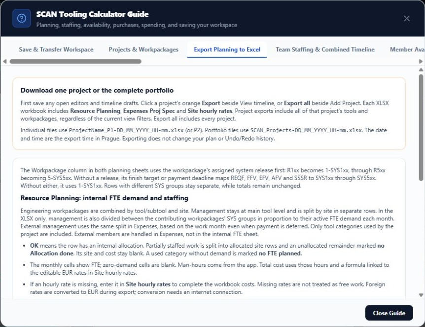

- Line 171: First save any open editors and timeline drafts. Click a project's orange Export beside View timeline, or Export all beside Add Project. Each XLSX workbook includes Resource Planning, Expenses Proj Spec and Site hourly rates. Project exports include all of that project's tools and workpackages, regardless of the current view filters. Export all includes every project.
- Line 177: Engineering workpackages are combined by tool/subtool and site. Management stays at main tool level and is split by site in separate rows. In the XLSX only, management is also divided between the contributing workpackages' SYS groups in proportion to their active FTE demand each month. External management uses the same split in Expenses, based on the work month even when payment is deferred. Only tool categories used by the project are included. External members are handled in Expenses, not in the internal FTE sheet.
- Line 186: Purchases keep their names and effective payment schedules, including saved payment overrides and reusability. Allocated external salaries are combined by tool family, site and payment delay; external engineering and management can share a row. Unused external salary is excluded from project expenses.

### Non-FTE Purchases

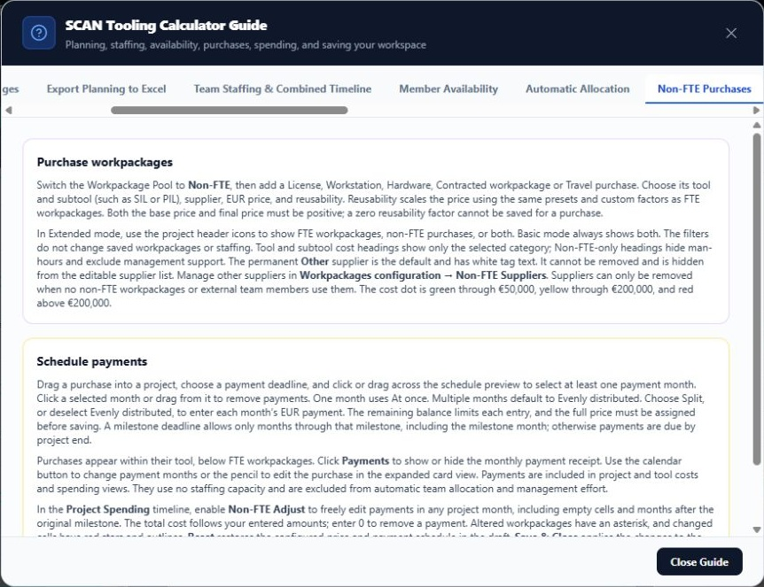

- Line 200: Switch the Workpackage Pool to Non-FTE, then add a License, Workstation, Hardware, Contracted workpackage or Travel purchase. Choose its tool and subtool (such as SIL or PIL), supplier, EUR price, and reusability. Reusability scales the price using the same presets and custom factors as FTE workpackages. Both the base price and final price must be positive; a zero reusability factor cannot be saved for a purchase.
- Line 201: In Extended mode, use the project header icons to show FTE workpackages, non-FTE purchases, or both. Basic mode always shows both. The filters do not change saved workpackages or staffing. Tool and subtool cost headings show only the selected category; Non-FTE-only headings hide man-hours and exclude management support. The permanent Other supplier is the default and has white tag text. It cannot be removed and is hidden from the editable supplier list. Manage other suppliers in Workpackages configuration → Non-FTE Suppliers. Suppliers can only be removed when no non-FTE workpackages or external team members use them. The cost dot is green through €50,000, yellow through €200,000, and red above €200,000.
- Line 206: Purchases appear within their tool, below FTE workpackages. Click Payments to show or hide the monthly payment receipt. Use the calendar button to change payment months or the pencil to edit the purchase in the expanded card view. Payments are included in project and tool costs and spending views. They use no staffing capacity and are excluded from automatic team allocation and management effort.

### External Members & Salaries

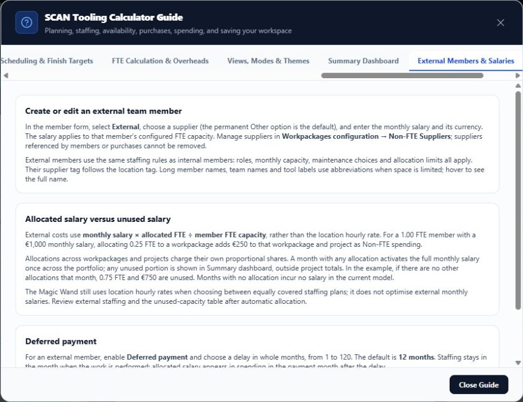

- Line 236: External members use the same staffing rules as internal members: roles, monthly capacity, maintenance choices and allocation limits all apply. Their supplier tag follows the location tag. Long member names, team names and tool labels use abbreviations when space is limited; hover to see the full name.

### Project Spending

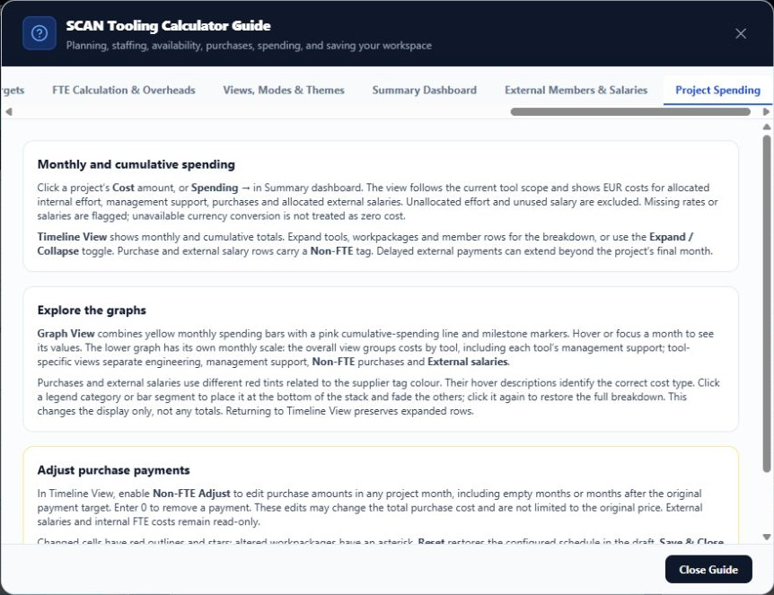

- Line 253: Click a project’s Cost amount, or Spending → in Summary dashboard. The view follows the current tool scope and shows EUR costs for allocated internal effort, management support, purchases and allocated external salaries. Unallocated effort and unused salary are excluded. Missing rates or salaries are flagged; unavailable currency conversion is not treated as zero cost.
- Line 254: Timeline View shows monthly and cumulative totals. Expand tools, workpackages and member rows for the breakdown, or use the Expand / Collapse toggle. Purchase and external salary rows carry a Non-FTE tag. Delayed external payments can extend beyond the project’s final month.
- Line 258: Graph View combines yellow monthly spending bars with a pink cumulative-spending line and milestone markers. Hover or focus a month to see its values. The lower graph has its own monthly scale: the overall view groups costs by tool, including each tool’s management support; tool-specific views separate engineering, management support, Non-FTE purchases and External salaries.

### Team Staffing & Combined Timeline

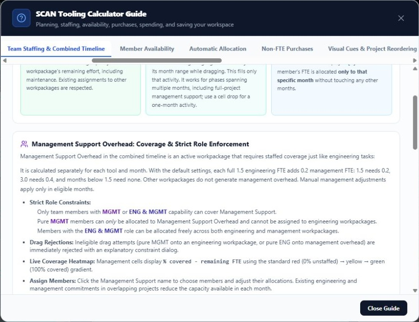

- Line 313: It is calculated separately for each tool and month. With the default settings, each full 1.5 engineering FTE adds 0.2 management FTE: 1.5 needs 0.2, 3.0 needs 0.4, and months below 1.5 need none. Other workpackages do not generate management overhead. Manual management adjustments apply only in eligible months.

### Scheduling & Finish Targets

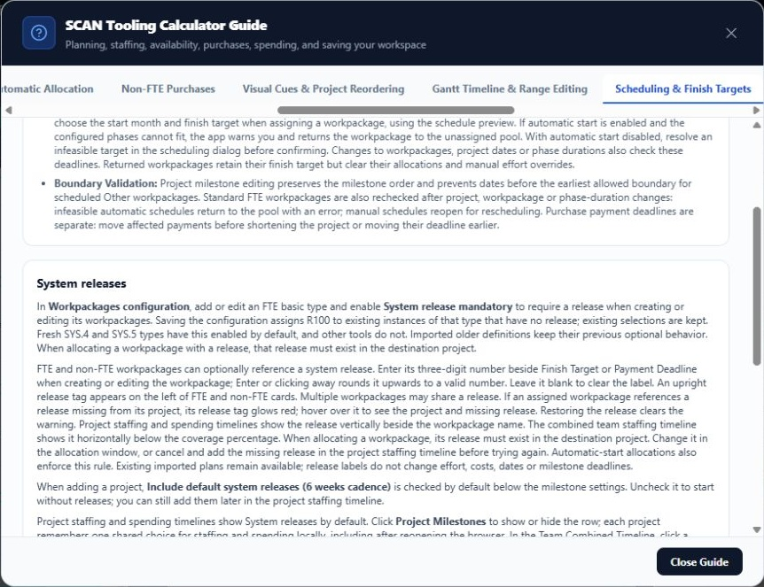

- Line 682: In Workpackages configuration, add or edit an FTE basic type and enable System release mandatory to require a release when creating or editing its workpackages. Saving the configuration assigns R100 to existing instances of that type that have no release; existing selections are kept. Fresh SYS.4 and SYS.5 types have this enabled by default, and other tools do not. Imported older definitions keep their previous optional behavior. When allocating a workpackage with a release, that release must exist in the destination project.

### FTE Calculation & Overheads

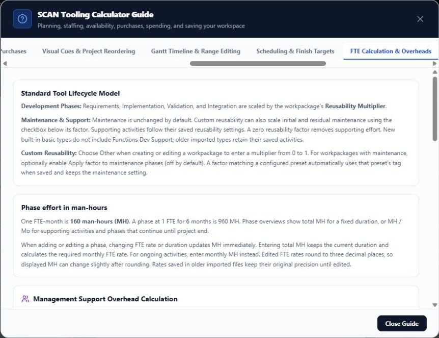

- Line 711: Standard Tool Lifecycle Model
- Line 740: Management support is calculated separately for each tool and month, excluding Other. With the default settings, each complete 1.50 FTE block of combined engineering demand in that month adds 0.20 FTE of management support: 1.50 FTE needs 0.20 FTE, 3.00 FTE needs 0.40 FTE, and an inactive or below-threshold month needs none. The settings can be changed in Defaults configuration. Saved management overrides cannot create demand in an inactive or below-threshold month. Management demand still needs eligible members to cover it.
- Line 754: Use the configuration icon beside the Workpackage Pool collapse button to open Workpackages configuration. Tool Phase Rates & Durations and Other workpackage defaults are configured there. Save Configuration applies the changes; Cancel discards them. Reset to Defaults in this window resets only these workpackage settings.
- Line 755: For a standard tool, enter a unique name and click Add basic type. Add phases with monthly FTE rates and durations, use the arrows to set their order, and choose which phases scale with reusability. Mark consecutive phases at the end as Not milestone bound to let them follow development beyond the finish milestone. Separately, the final phase can run to project end. Ordering controls prevent a milestone-bound phase from following an unbound phase. Other now starts with a Standard basic type containing one Main phase and no maintenance or supporting activities. It uses the same basic-type editor. Supporting activities appear below the ordered phases. Set their monthly FTE rate, reusability scaling and whether they continue during maintenance; they do not need a duration. Save the basic type, then Save Configuration to make it available in workpackage creation and editing. Reset retains custom types.
- Line 757: Project workpackages show their total resource cost in a yellow tag beside effort in cards and on workpackage rows in the team timeline: monthly allocated FTE × 160 working hours × the internal member's location hourly rate, summed across internal members and active months. External allocations use the member’s salary instead and count as Non-FTE cost; purchases add their payment amounts. Tool section headers sum their workpackage costs and the management support cost for that tool and project, beside FTE/yr. Individual management support rows show their own costs; the overall management support header shows only FTE. Amounts use k for thousands and M for millions. Collapsed cost tags omit currency and show whole thousands or at most one decimal for millions; hover for the full amount and currency. Collapsed project cards hide the effort tag when both tags would crowd the workpackage type, keeping the cost tag visible. Hover over a member's monthly allocation cell to see its cost, allocated hours, and hourly rate, including management support cells. Allocated maintenance and support are included. Cost tags appear only when a positive allocated cost exists. Workpackages, management support, and tool totals hide tags with no allocations, zero cost, or no configured rates for any allocated member. Team timeline workpackage rows omit the FTE summary. Missing rates for some members show a partial cost; hover over the cost for details. Team timeline costs reflect the draft until Save & Close.
- Line 760: The project header shows Cost: below Total in purple, including management support. Its outlined amount button follows the same tool scope as Total and displays the full rounded amount with a yellow € before the number; rates in another currency are converted automatically to EUR. The FTE and Non-FTE breakdown stays on one row, using k for thousands and M for millions when the full amounts do not fit. Hover over the breakdown for the full values; widening the column restores them when space allows.
- Line 763: Click the project's cost amount to open Project Spending. It shows monthly and cumulative spending in EUR, with tool, workpackage, and management support totals. Expand a workpackage to see each member's monthly cost, or use the Expand / Collapse toggle. Select Graph View to see cumulative spending as a line together with yellow monthly spending bars on one EUR scale. Hover or focus a month to see both values; the monthly spending amount is also yellow. Below it, the monthly breakdown stacks costs by tool, including each tool's management support. In a tool-specific view, engineering and purple management support remain separate. Click a legend category or bar segment to move it to the bottom and fade the others; click it again to restore the full view. The upper chart shows milestone tags at their scheduled months. Timeline View returns to the detailed breakdown. The summary includes average monthly spending and the peak month. This view follows current allocations; unallocated effort is not priced. Missing hourly rates or salaries are flagged. The allocated portion of external monthly salaries is included in Non-FTE spending. Summary dashboard shows unused paid effort and salary across all projects; unused salary is excluded from project costs.

### Views, Modes & Themes

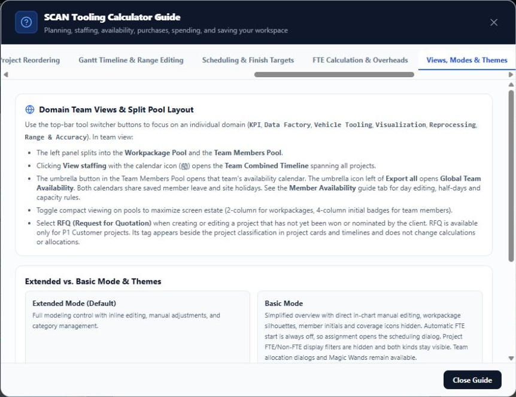

- Line 828: Use the top-bar tool switcher buttons to focus on an individual domain (KPI, Data Factory, Vehicle Tooling, Visualization, Reprocessing, Range & Accuracy). In team view:

## Keep or decide separately

- Vehicle Tooling and Vehicle Mount Tool are actual category/workpackage names. They are not generic category labels to replace automatically.
- The Tools wrench icon represents equipment, not a workpackage category.
- Other leave tool describes the calendar editing control and should remain.
- Workpackage definition tool refers to the application itself, not a category.
- SCAN Tooling Effort Calculator / SCAN Tooling Calculator Guide is branding. Consider a separate naming decision for cross-department use.
- Internal identifiers such as tool, toolFteRates, hiddenTools and the scan-allocation-tool file format are implementation/compatibility details. A terminology refresh must not silently break historical JSON.
